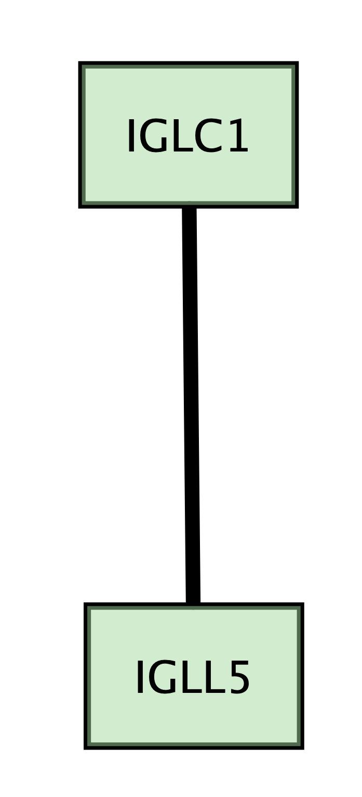

# GRN_GNN
This github page outlines the pipeline, codes and results for the Graph Neural Network.

## Overview

This project uses a **Graph Convolutional Network (GCN)** to reconstruct Gene Regulatory Networks (GRNs) from gene expression data. A GCN is a type of neural network built to operate directly on graph-structured data (genes and their connections) rather than plain rows of numbers. It works by having each gene node repeatedly "look at" its neighbors in the network and update its own representation based on that neighborhood information, layer by layer. This lets the model learn which gene-gene connections are meaningful, not just which ones show up in the raw input data. Here, the GCN is used as the encoder in a graph autoencoder, which compresses each gene into a latent representation and then reconstructs the network from it, keeping the high-confidence edges and filtering out noise.

The GCN-derived networks show strong performance, consistently outperforming raw/traditional GRN reconstruction on standard evaluation metrics (AUROC, F1-score) in benchmark testing.

## COVID-19 results

We applied the model to a COVID-19 antiviral response dataset (blood samples from hospitalized COVID-19 patients). Compared to the raw network, the GCN-derived network picked out key immune-related gene interactions — including **OAS2, OAS3, DDX60, MX1**, and **DHX58–ISG15** — that line up well with known antiviral response pathways. These genes are established players in the interferon-induced host defense against coronaviruses, supporting the model's ability to recover biologically relevant interactions.

| Raw GRN | GCN GRN |
|:---:|:---:|
|  |  |

*Figure: Comparison of the raw GRN (left) and GCN-derived GRN (right) for the COVID-19 dataset. The GCN network surfaces well-established antiviral genes that the raw network misses.*

### What these genes do

| Gene | Role in antiviral response | Reference |
|------|------|-----------|
| **OAS2 / OAS3** | Synthesize 2'-5' oligoadenylates that activate RNase L, which degrades viral RNA and blocks viral replication; part of the interferon-induced host defense against coronaviruses. | Schwartz & Conn, 2019 [1]; Hancks et al., 2015 [2] |
| **DDX60** | A DEAD/H-box RNA helicase that amplifies RIG-I-like receptor signaling, a key pathway for sensing viral RNA and triggering innate immune responses. | Tapescu & Cherry, 2024 [3] |
| **MX1** | A GTP-metabolizing, interferon-stimulated protein with a well-established role in cellular antiviral defense and cytokine signaling. | Ashley et al., 2019 [4] |
| **DHX58** | Involved in negative regulation of type I interferon production, helping balance a strong antiviral response against overactive immune signaling. | de Lang et al., 2020 [5] |
| **ISG15** | An interferon-stimulated gene with direct antiviral activity; forms a complex with DHX58 during viral infection that acts as a repressor of the response. | Sarkar, Liu & Gack, 2023 [6] |

These genes were cross-checked against the STRING functional-association database [7] and known coronavirus host-pathogen interferon-induction pathways, and consistently show up as central, well-supported players — reinforcing that the GCN model is picking up biologically meaningful signal rather than noise.

1. Schwartz, S.L. & Conn, G.L. (2019). RNA regulation of the antiviral protein 2-5-oligoadenylate synthetase. *Wiley Interdisciplinary Reviews: RNA*, 10(4):e1534.
2. Hancks, D.C. et al. (2015). Overlapping patterns of rapid evolution in the nucleic acid sensors cGAS and OAS1 suggest a common mechanism of pathogen antagonism and escape. *PLOS Genetics*, 11(5):e1005203.
3. Tapescu, I. & Cherry, S. (2024). DDX RNA helicases: key players in cellular homeostasis and innate antiviral immunity. *Journal of Virology*, 98(10):e00040-24.
4. Ashley, C.L. et al. (2019). Interferon-independent upregulation of interferon-stimulated genes during human cytomegalovirus infection is dependent on IRF3 expression. *Viruses*, 11(3):246.
5. de Lang, A., Osterhaus, A.D. & Haagmans, B.L. (2020). Interferon-γ and interleukin-4 downregulate expression of the SARS-CoV receptor ACE2 in Vero E6 cells. *SARS Pathogenesis: Host Factors*, 103.
6. Sarkar, L., Liu, G. & Gack, M.U. (2023). ISG15: its roles in SARS-CoV-2 and other viral infections. *Trends in Microbiology*.
7. von Mering, C. et al. (2003). STRING: a database of predicted functional associations between proteins. *Nucleic Acids Research*, 31(1):258-261.
