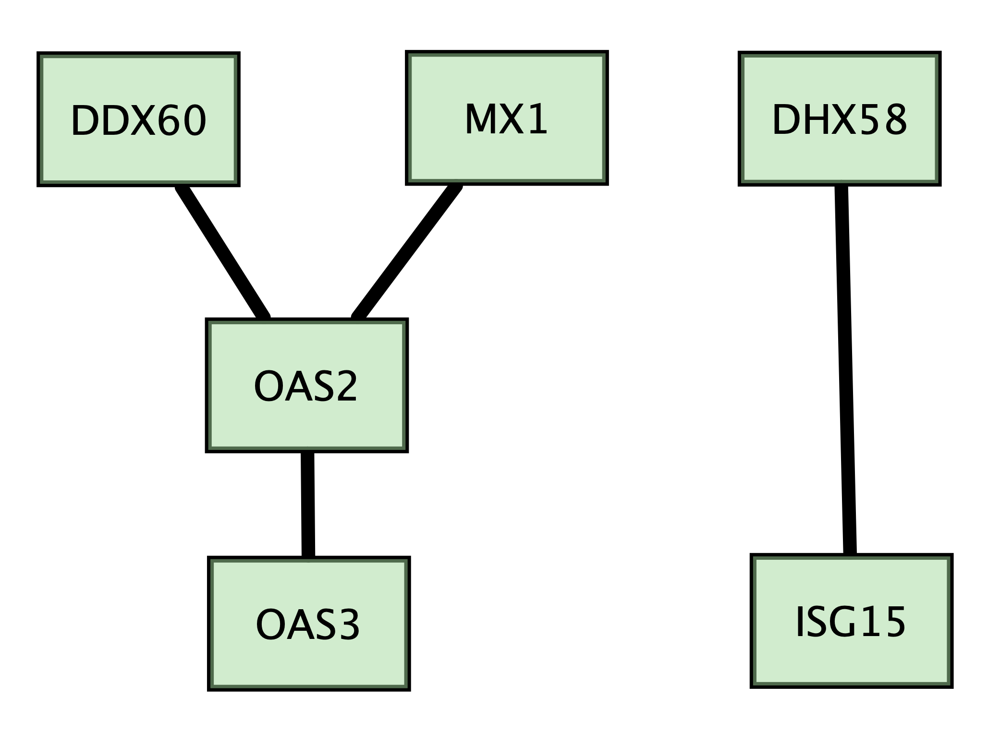

# GRN_GNN
This github page outlines the pipeline, codes and results for the Graph Neural Network.

## Overview

This project uses a **Graph Convolutional Network (GCN)** to reconstruct Gene Regulatory Networks (GRNs) from gene expression data. A GCN is a type of neural network built to operate directly on graph-structured data (genes and their connections) rather than plain rows of numbers. It works by having each gene node repeatedly "look at" its neighbors in the network and update its own representation based on that neighborhood information, layer by layer. This lets the model learn which gene-gene connections are meaningful, not just which ones show up in the raw input data. Here, the GCN is used as the encoder in a graph autoencoder, which compresses each gene into a latent representation and then reconstructs the network from it, keeping the high-confidence edges and filtering out noise.

The GCN-derived networks show strong performance, consistently outperforming raw/traditional GRN reconstruction on standard evaluation metrics (AUROC, F1-score) in benchmark testing.

## COVID-19 results

We applied the model to a COVID-19 antiviral response dataset (blood samples from hospitalized COVID-19 patients). Compared to the raw network, the GCN-derived network picked out key immune-related gene interactions — including **OAS2, OAS3, DDX60, MX1**, and **DHX58–ISG15** — that line up well with known antiviral response pathways. These genes are established players in the interferon-induced host defense against coronaviruses, supporting the model's ability to recover biologically relevant interactions.

| Raw GRN | GCN GRN |
|:---:|:---:|
|  |  |

*Figure: Comparison of the raw GRN (left) and GCN-derived GRN (right) for the COVID-19 dataset. The GCN network surfaces well-established antiviral genes that the raw network misses.*
